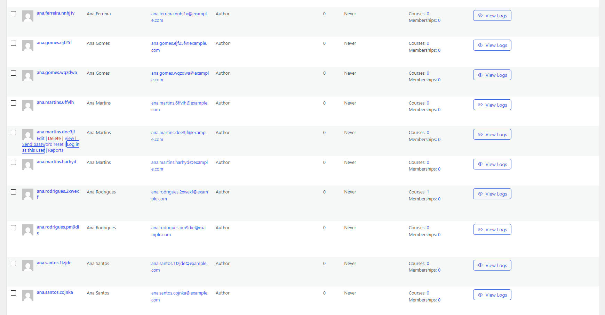
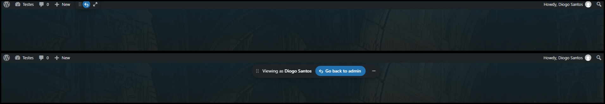

# Just Wanna Be a User

A WordPress plugin that lets admins log in as any user from the Users screen, then jump straight back to their own account.

## Requirements

- WordPress 5.9 or later
- PHP 7.4 or later

## Installation

1. Copy the `just-wanna-be-a-user` folder into `wp-content/plugins/`.
2. Activate **Just Wanna Be a User** on the **Plugins** screen.

## Usage

1. Go to **Users** and hover over a user.
2. Click **Log in as this user**. You are logged in as that user and sent to the site's homepage.
3. A bar pinned to the top center of the page shows who you're viewing as. Click **Go back to admin** to return to your own account on the Users screen.
4. Drag the bar anywhere by its grip, or click **−** to shrink it to two small buttons: back to admin and expand. Double-click the grip to put it back at the top center. Your browser remembers its position and state.

The link only appears for users you're allowed to edit (`edit_user`), and never on your own row.

### Settings

To land somewhere else, go to **Tools > Just Wanna Be a User**, or click **Settings** under the plugin on the Plugins screen. You need `manage_options`.

| Setting | Default | Other presets | A custom path is relative to |
| --- | --- | --- | --- |
| After logging in as a user | Site homepage | Dashboard, Profile | the site's home URL |
| After going back to admin | Users screen | Dashboard, Site homepage | `wp-admin/` |

## Screenshots

**The "Log in as this user" link on the Users screen**



**The "Go back to admin" bar while logged in as another user**



## How it works

`just-wanna-be-a-user.php` only loads the two classes in `includes/`:

- `JWBAU_User_Switcher` (`class-jwbau-user-switcher.php`) handles switching in, switching back and the floating bar.
- `JWBAU_Settings` (`class-jwbau-settings.php`) runs the Tools page. It also resolves the two landing URLs through `JWBAU_Settings::url( 'switch_to' )` and `JWBAU_Settings::url( 'switch_back' )`.

**Switching in** (`admin-post.php?action=jwbau_switch_to`)

1. The nonce and the `edit_user` capability are checked.
2. The admin's current session token is kept alive, and a signed reference to it is generated with `wp_generate_auth_cookie()`. It's stored in an HttpOnly session cookie named `jwbau_origin_{COOKIEHASH}`. That's a strictly necessary authentication cookie, set only on the admin's click, so it isn't gated on cookie consent.
3. The auth cookies are swapped to the target user, then the browser is redirected to the "After logging in as a user" page.

**Switching back** (`?jwbau_switch_back=1&_wpnonce=…` on any front-end URL)

1. This runs on `init` at priority 0, before maintenance-mode plugins that block on `init`.
2. The nonce is checked, and the origin cookie is validated with `wp_validate_auth_cookie()`. That only passes while the admin's original session is still active.
3. The target user's temporary session is destroyed, and the admin's original session token is restored.
4. The browser is redirected to the "After going back to admin" page.

**The "Go back to admin" bar**

- It prints on `wp_footer` and `admin_footer`.
- Many pages exit before the footer, for example maintenance-mode screens and `wp_die()` permission errors. For those, a `shutdown` fallback prints the bar with its styles and script. It only does this for HTML responses: it skips redirects, AJAX, REST, XML-RPC, cron and non-`text/html` content types.
- Its CSS and JS are inline, so there are no asset files to load. Without JavaScript the bar still works, but you can't move or minimize it.
- The minimized state and position are kept in `localStorage` under `jwbau_bar`. When the bar has been placed, it's kept fully on screen on every resize or expand.

**Settings**

- They're stored in one option, `jwbau_settings`.
- Custom paths are saved relative to their base URL. Off-site URLs are dropped on save, and `wp_validate_redirect()` checks the final URL again before every redirect.
- `uninstall.php` deletes the option. The plugin creates no tables.

## Development

With [WordPress Coding Standards](https://github.com/WordPress/WordPress-Coding-Standards) installed, run from the plugin folder:

```bash
phpcs --standard=WordPress --runtime-set text_domain just-wanna-be-a-user --ignore=vendor .
```

Before a release, also run the [Plugin Check](https://wordpress.org/plugins/plugin-check/) plugin against it.

## Security

Found a security issue? Please report it privately through [GitHub's private vulnerability reporting](https://github.com/vPereira04/just-wanna-be-a-user/security/advisories/new), rather than in the public support forum. See [SECURITY.md](SECURITY.md) for the full policy.

## Changelog

Releases that fix a security issue say so in their entry, prefixed with **Security:**. The full history is in [CHANGELOG.md](CHANGELOG.md).

### 1.0.0

- Initial release.

## License

GPLv2 or later. See <https://www.gnu.org/licenses/gpl-2.0.html>.
